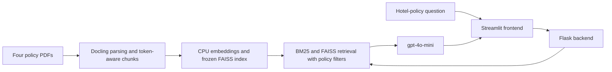

# AuroraStays Policy Desk

[](LICENSE)
[](https://codespaces.new/scottpwells/AuroraStays--QnA/tree/codespaces-deployment)

AuroraStays is a hotel-policy question-answering app for staff. It searches the four policy PDFs included in this repository and uses retrieval-augmented generation (RAG) to produce an answer with supporting policy excerpts and source filenames.

Ask about bookings, cancellations, refunds, pet fees, rooms, amenities, or accessibility. For example: **“What are the pet fees at ASH-CHI Loop?”** Choose **Answer only** or **Answer with sources** in the Streamlit interface.

## What it does

- Combines semantic FAISS search with BM25 retrieval and property-aware filtering.
- Preserves policy sections and table context through structured, token-aware chunking.
- Generates answers with `gpt-4o-mini` and shows the policy evidence used to answer.
- Separates a Streamlit frontend from a Flask/Gunicorn backend; API credentials stay in the backend.
- Includes a worked notebook, an HTML export, regression tests, and Docker/Codespaces deployment files.

## How it works



The checked-in index contains **139 normalized vectors with 384 dimensions**. The embedding model is [`HarishMaths/Hotel-Policy-Embedding`](https://huggingface.co/HarishMaths/Hotel-Policy-Embedding), pinned to the revision in the [deployment manifest](backend_files/deployment_manifest.json). The notebook prepares the index; application startup verifies and loads it.

The evaluated answer defaults are **K = 4**, **temperature = 0**, **top_p = 1**, and **max_tokens = 512**. The UI exposes retrieval count, temperature, and answer length as advanced settings.

## Quick start: GitHub Codespaces

1. Use **Open in GitHub Codespaces** above to create a Codespace from `codespaces-deployment`. Select at least **2 CPU cores, 8 GB RAM, and 32 GB storage**.
2. Add Codespaces secrets named `OPENAI_API_KEY` and `OPENAI_API_BASE`, granting this repository access. Use your provider's API key and compatible API base URL. Stop and restart an existing Codespace after adding secrets.
3. Wait for automatic application startup and health checks. The first build downloads Python dependencies and the pinned embedding model.
4. Open port **8501** in the Ports panel and keep its visibility **Private**. Select **Answer with sources**, enter a question, and click **Ask**.

If secrets were missing during startup, configure them and run `python scripts/start-codespaces.py` from the Codespace terminal. Stop the Codespace when finished. See [DEPLOYMENT.txt](DEPLOYMENT.txt) for diagnostics and authenticated notebook access.

## Run locally with Docker

Prerequisites: Git, Docker with Linux containers, Docker Compose v2, internet access for the first build, and compatible API credentials. A GPU and a host Python environment are not required to run the containers.

```sh
git clone --branch codespaces-deployment https://github.com/scottpwells/AuroraStays--QnA.git
cd AuroraStays--QnA
```

Create a file named `.env` in the repository root and set these values:

```dotenv
OPENAI_API_KEY=REPLACE_WITH_YOUR_API_KEY
OPENAI_API_BASE=https://api.openai.com/v1
```

The base URL above is for direct OpenAI access; use your provided base URL when connecting through another compatible provider. `.env` is ignored by Git. Never commit real credentials.

```sh
docker compose -p aurorastays up --build --detach --wait --wait-timeout 240
docker compose -p aurorastays ps
```

Open **http://127.0.0.1:8501**. The backend is available on **http://127.0.0.1:7860** for local diagnostics; the frontend connects to it through Docker's internal network.

```sh
# View service logs and stop the local stack.
docker compose -p aurorastays logs --tail 80
docker compose -p aurorastays down
```

Questions that generate answers consume usage on your configured API account. Health checks and policy retrieval do not call the LLM.

## Explore the notebook on Windows

The notebook environment uses **CPython 3.12.10** with a **245-package lock file**. The application containers use **Python 3.13.15** and their own pinned requirements.

From PowerShell in the repository root, with Python/pip available to bootstrap the setup:

```powershell
.\scripts\setup-environment.ps1
# Create this only if you do not already have config.json.
Copy-Item config.example.json config.json
```

Edit the ignored `config.json` locally to provide `OPENAI_API_KEY` and `OPENAI_API_BASE`, then launch Jupyter:

```powershell
.\scripts\start-notebook.ps1
```

Select **AuroraStays (Python 3.12.10)**. [Full_Code_Notebook.ipynb](Full_Code_Notebook.ipynb) contains the walkthrough and saved outputs; [Full_Code_Notebook.html](Full_Code_Notebook.html) provides a browser-readable export. Local caches are ignored by Git and are not included in a fresh clone. Follow the notebook sections in order when rebuilding state, and review API-using cells before executing them.

The full notebook environment is not installed automatically in Codespaces. See [SETUP_REPORT.txt](SETUP_REPORT.txt) for the detailed environment and verification record.

## API

Base URL: `http://127.0.0.1:7860` when running locally or inside the Codespace.

| Method | Endpoint | Response |
| --- | --- | --- |
| `GET` | `/` | Service welcome/readiness response. |
| `POST` | `/v1/relevant_chunks` | Supporting policy chunks without LLM generation. |
| `POST` | `/v1/answer` | Generated answer. |
| `POST` | `/v1/answer_with_relevant_chunks` | Generated answer, policy chunks, and request parameters. |

Example JSON request body:

```json
{
  "query": "What are the pet fees at ASH-CHI Loop?",
  "k": 4
}
```

Answer endpoints also accept `model_name`, `temperature`, `top_p`, and `max_tokens`; omitted values use the evaluated defaults above. Invalid inputs return HTTP `400`; provider failures return a sanitized HTTP `502` response. The backend has no application-level authentication, so retain the loopback bindings and private Codespaces forwarding in the supplied setup.

## Validation and evaluation

With the Windows notebook environment installed, run the offline regression tests and deployment artifact check:

```powershell
.\.venv\Scripts\python.exe -m unittest discover -s tests -v
.\.venv\Scripts\python.exe scripts/check-deployment.py
```

With both services running, `python scripts/smoke-deployment.py` checks HTTP health and real policy retrieval without paid LLM calls. The [deployment workflow](.github/workflows/deployment-check.yml) builds both images and runs those checks with a dummy API key. Local Docker and actual Codespaces runtime/browser checks are documented in [SETUP_REPORT.txt](SETUP_REPORT.txt).

The frozen configuration was evaluated once on **10 held-out questions**, using DeepEval with a `gpt-4o` judge. Saved mean scores are:

| Metric | Mean score (0–1) |
| --- | ---: |
| Faithfulness | 0.9951 |
| Contextual recall | 0.9581 |
| Contextual precision | 0.8285 |
| Answer relevancy | 0.9143 |

Eight of ten questions passed all four configured thresholds. These are small-sample, LLM-judged results, not calibrated confidence or a guarantee of correctness. Review source policies before relying on an answer. The live app does not compute the notebook's offline evaluation/routing scores for new questions. Use development data for further tuning and preserve the held-out results; evaluation runners make paid API calls.

## Project layout

| Location | Purpose |
| --- | --- |
| [frontend_files/](frontend_files/) | Streamlit UI, frontend requirements, and Dockerfile. |
| [backend_files/](backend_files/) | Flask API, generation helpers, frozen index, manifest, and Dockerfile. |
| [policy_retrieval.py](policy_retrieval.py) | Structured chunking and policy-aware hybrid retrieval. |
| [Full_Code_Notebook.ipynb](Full_Code_Notebook.ipynb) | Data preparation, retrieval, generation, evaluation, and deployment walkthrough. |
| [scripts/](scripts/) and [tests/](tests/) | Environment setup, launchers, verification tools, and regression tests. |
| [compose.yaml](compose.yaml) and [.devcontainer/](.devcontainer/) | Local container orchestration and Codespaces configuration. |
| [requirements-notebook.lock.txt](requirements-notebook.lock.txt) | Exact Windows notebook dependency versions. |

## Contributing and support

Maintained by [@scottpwells](https://github.com/scottpwells). Report bugs or propose improvements through [GitHub Issues](https://github.com/scottpwells/AuroraStays--QnA/issues). Include reproduction steps and relevant logs with credentials removed.

For contributions, keep pull requests focused, run the offline tests, and update documentation for behavior changes. Changes to retrieval, models, or the index should include development-set validation and matching deployment artifacts; do not tune against the recorded held-out test set.

## License

Project source code and original documentation are licensed under the **[MIT License](LICENSE)**. Copyright © 2026 scottpwells. Third-party dependencies, pretrained models, and externally supplied policy documents or datasets retain their own licensing terms.
